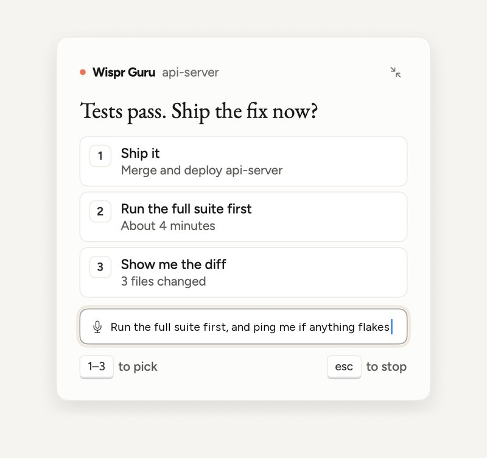
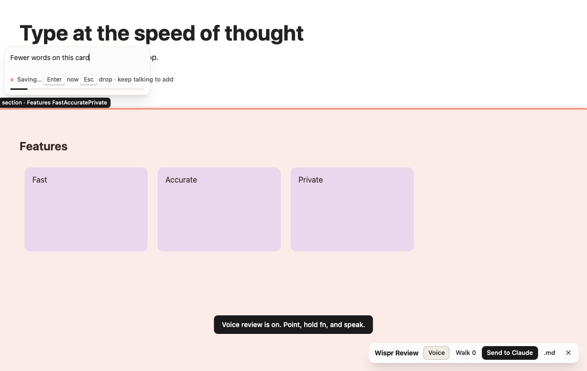
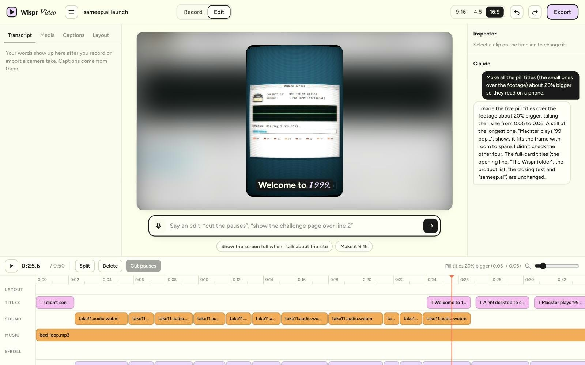
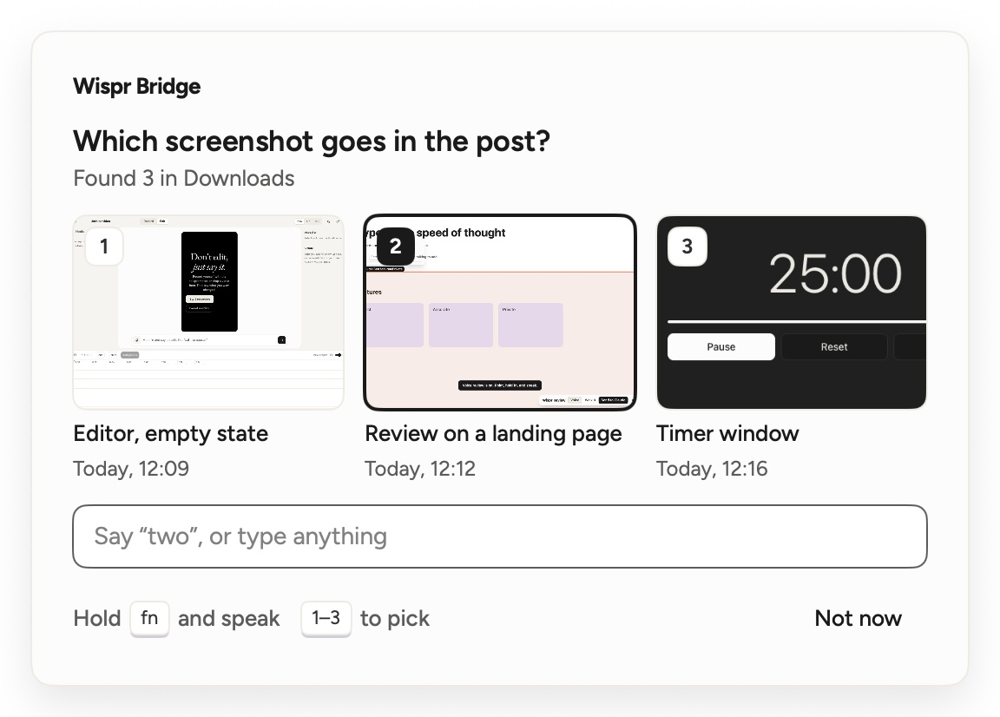
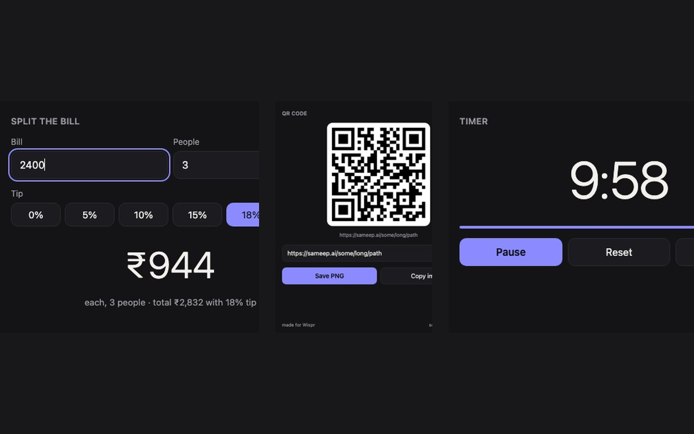

# Wispr for Builders · Pack 1

**Talk back to Claude Code, from the middle of anything.** When a Claude Code thread finishes or
needs a call, a small card drops in from the notch, and you answer it with
[Wispr Flow](https://wisprflow.ai) without switching windows. That's Wispr Guru, the first of seven
Claude Code mods in Pack 1. One install, all running on your Mac. By [Sameep Rehlan](https://sameep.ai).



Voice is for dictation: say the real answer, the note, the search. Actions are clicks, number keys,
or done for you when Guru sees the step happen. The mods don't open your microphone: they read what
Wispr Flow types into a focused field. The one exception is Wispr Video's recorder, which uses the
mic while you record.

## Install the whole pack

Give this repo to your Claude and say:

```text
Install Wispr for Builders pack 1 from https://github.com/sameeeeeeep/wispr-for-builders
```

Claude clones it, reads [CLAUDE.md](CLAUDE.md) and runs `./install.sh`. Or do it yourself:

```sh
git clone https://github.com/sameeeeeeep/wispr-for-builders && cd wispr-for-builders && ./install.sh
```

Or add it as a Claude Code plugin marketplace and pick mods one at a time:

```text
/plugin marketplace add sameeeeeeep/wispr-for-builders
/plugin install wispr-file@wispr-for-builders
```

Needs macOS 13+, Claude Code, Node 18+ and Wispr Flow. Wispr Wish and Wispr Video also use
`ffmpeg` and `whisper-cpp` (`brew install ffmpeg whisper-cpp`).

---

## The mods

Strongest first.

### Wispr Guru · talk back to Claude Code, from the notch

> "run the full suite first, and ping me if anything flakes"

When a long Claude turn finishes, or Claude needs a decision, Guru plays a short sound and drops a
card in from the notch with the question and its options. Click one, press its number, or dictate
a real answer with Wispr, and it goes straight back to that thread. Guru also walks you through any
app: it points at the control you need, shows the step beside it, and moves on when you click it.

```text
/plugin install wispr-guru@wispr-for-builders
```

### Wispr Review · review a website by talking at it

> Point at the headline, hold fn and dictate "too big on mobile". Point at the price: "say per seat".

A Chrome extension pins each dictated note to the element under your cursor, with a crop, the
selector and the URL. Notes go to a local inbox, and Claude reads them with `/wispr-review` and
fixes them one by one.



```text
/plugin install wispr-review@wispr-for-builders
```

Then load `plugins/wispr-review/extension` in chrome://extensions (Developer mode, Load unpacked)
and press Option+Shift+R on any site.

### Wispr PM · your task boards, dictated (in progress)

> "park this for the portfolio" · "split this into tasks" · "what's waiting on me"

One Markdown board per project. Parked items become cards, and what's next comes back as a numbered
card. Click Start on a card and a Claude Code session works on it, then moves it to review when
it's done. Still being built, so expect rough edges.

```text
/plugin install wispr-pm@wispr-for-builders
```

### Wispr Video · a video editor you talk to

> "cut the silences" · "captions on, highlight the product name" · "export 9:16"

Record with a teleprompter that follows you as you read, add a screen take, and get word-timed
captions from an on-device transcript. Describe the edit and Claude changes the timeline while you
watch. Exports 9:16, 4:5 and 16:9 with ffmpeg.



```text
/plugin install wispr-video@wispr-for-builders
```

### Wispr File · find any file by describing it

> "the GST invoice from October" · "last screenshot of the admin panel" · "the signed lease PDF"

Spotlight searches your Mac and the results come back as a numbered card of thumbnails. Click one
or press its number, and File pastes it into the app you were in, or reveals, opens or copies it.
File contents never leave your Mac.



```text
/plugin install wispr-file@wispr-for-builders
```

### Wispr Wish · say what should happen to a file

> "make this a PDF" · "compress this video for WhatsApp" · "turn these PNGs into WebP" ·
> "transcribe this audio" · "a timer for 25 min" · "split this bill three ways" · "a QR for this link"

Acts on what you selected in Finder, using ffmpeg and a local whisper transcript. Ask for a small
tool and it opens one in its own window. It answers questions instead of acting on them, and asks
before deleting anything.



```text
/plugin install wispr-wish@wispr-for-builders
```

### Wispr Bridge · what ties them together

`wispr-bridge ask` opens a small field. Dictate any request and it goes to the mod that handles
it. Every mod shows choices on the same numbered card: pick with a click or a number key, and
dictate anything longer. It installs with the pack, and other mods can use it: see
[plugins/wispr-bridge/API.md](plugins/wispr-bridge/API.md).

```text
/plugin install wispr-bridge@wispr-for-builders
```

---

## Also, and coming

- **[Wispr Wrapped](https://sameep.ai/wispr-wrapped/)**, the fun one: your real Flow history as a story.
- **Wispr Social** (in progress): plan posts by talking, with a calendar and a reminder at post time.
- **Pack 2, for editors**: for people who have Claude but haven't found what to use it for.
- **Pack 3, for designers**.
- A global hotkey for `wispr-bridge ask`. For now, bind it with Raycast or Shortcuts.

## What runs where

Everything runs on your Mac. A few things call Claude through your own `claude` CLI: the bridge's
router and anything you dictate to it, wispr-file's fallback when nothing matches (the request
text only; turn it off with `WISPR_FILE_LOCAL=1`), and wispr-pm's split and unclear phrases. File
contents are never sent. Each mod's README in `plugins/` says exactly what it reads and writes.

## License

MIT. See [LICENSE](LICENSE). The fonts are under the SIL Open Font License.
